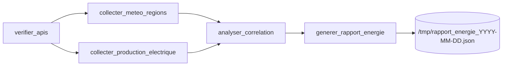

# Airflow Energy & Weather Pipeline

A daily **Apache Airflow** pipeline that crosses weather forecasts with renewable-energy production for five French regions and flags anomalies, for example "lots of sun but low solar output". It runs in Docker and uses two public APIs that need no API key.


## What it does

For Île-de-France, Occitanie, Nouvelle-Aquitaine, Auvergne-Rhône-Alpes and Hauts-de-France, every day at 06:00 (Europe/Paris), the DAG:

1. checks that both APIs are up,
2. collects sunshine duration and maximum wind speed ([Open-Meteo](https://open-meteo.com/)),
3. collects solar and wind production in MW ([eCO2mix regional data via OpenDataSoft](https://odre.opendatasoft.com/)),
4. applies business rules to correlate the two,
5. writes a JSON report and prints a summary table in the task logs.

## Architecture



Task data is passed between steps with XCom. In code: `t1 >> [t2, t3] >> t4 >> t5`.

### Business rules

| Rule | Condition | Result |
|---|---|---|
| Solar alert | sunshine > 6 h **and** solar output ≤ 1,000 MW | `ALERTE` |
| Wind alert | wind > 30 km/h **and** wind output ≤ 2,000 MW | `ALERTE` |
| Data anomaly | solar output > 0 **and** sunshine = 0 h | flagged |

Each region ends up as `OK` or `ALERTE`, with its metrics and the list of triggered alerts.

### Details worth noting

- **Time zone:** the DAG uses `Europe/Paris` so the schedule stays correct across daylight-saving changes.
- **`catchup=False`:** a new deployment does not backfill past days.
- **Resilience:** 2 retries with a 5-minute delay, an SLA of 90 minutes with a logging `sla_miss_callback`, and `timeout` on every HTTP call.
- **Nulls:** missing API values default to `0.0` before aggregation.

## DAGs in this repo

| File | Purpose |
|---|---|
| `dags/energie_meteo_dag.py` | Main pipeline: classic `PythonOperator` version |
| `dags/energie_meteo_dag_dynamic.py` | Same pipeline with TaskFlow API and **dynamic task mapping** (`.expand()`), regions configurable via an Airflow Variable |
| `dags/sla_test_dag.py` | SLA miss and alerting experiment |
| `dags/dag_broken.py` | Deliberately faulty DAG used for debugging practice |
| `dags/exercice_jour1.py`, `dags/hello_world.py` | Introductory examples |

## Quickstart

**Prerequisites:** Docker with Compose v2, about 4 GB of RAM for Docker, port 8080 free.

```bash
# 1. Get the official Airflow Docker Compose file for the version you want
#    (see the Airflow docs, "Running Airflow in Docker") and save it as docker-compose.yaml

# 2. Create .env (git-ignored)
echo "AIRFLOW_UID=50000" > .env
#    also set the web UI login variables described in the Airflow docs

# 3. Initialise, then start
docker compose up airflow-init
docker compose up -d

# 4. Open http://localhost:8080 and trigger energie_meteo_dag
```

Read the generated report:

```bash
docker compose exec airflow-scheduler cat /tmp/rapport_energie_$(date +%Y-%m-%d).json
```

Credentials are never committed. Set them in your local `.env`.

## Project structure

```
dags/     Airflow DAG definitions
docs/     design notes
```

`logs/`, `plugins/`, `.env` and `docker-compose.yaml` are local runtime files, not part of the repo.

## Limitations

- The `docker-compose.yaml` is not included. It's the official Airflow one, to be downloaded for your version.
- There are no automated tests and no CI yet.
- eCO2mix is queried with `limit=100`, so the "daily average" is computed over a sample of recent records, not the full day.

## Data sources

- Open-Meteo: weather forecast API
- eCO2mix regional consolidated data, published by RTE on OpenDataSoft

Check each provider's terms of use before reuse.
